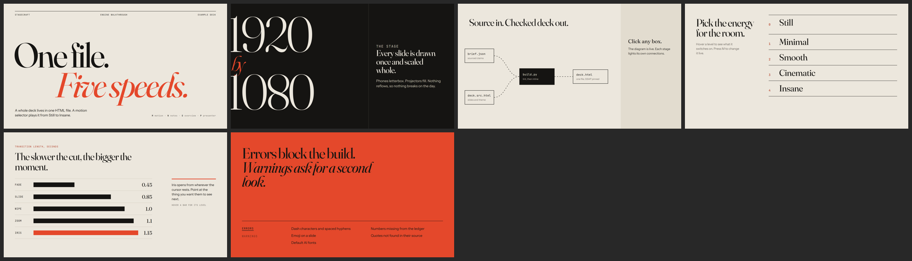

# stagecraft

A Claude skill that builds art-directed presentations from real material (a codebase, docs, papers, notes) and only says what that material supports.



- **Single-file HTML decks** on a fixed 1920x1080 stage, with a GSAP motion engine and a live motion selector: Still, Minimal, Smooth, Cinematic, Insane.
- **Interactive pieces**: clickable architecture diagrams with flowing edges, animated charts, step builds, tabs, hover reveals, canvas effects, presenter window with notes and citations.
- **Grounded content**: every fact goes into a claim ledger (`brief.json`) with a verbatim quote and a locator. The build fails if a slide shows a number that is not in the ledger, or if a quote is not found in its source file.
- **Writing rules enforced by lint**: no dash characters, no emoji, no stock AI phrasing, no generic titles like "Overview".
- **Native PPTX** too: editable charts, connected diagrams, speaker notes, and Morph transitions mapped from the motion level.
- **Self-checks**: a headless Chrome audit flags offstage, clipped, overlapping, tiny and low-contrast text, then saves a contact sheet to review.

Open `docs/example-deck.html` in Chrome to try one. Press `M` to change the motion level, `N` for notes, `O` for overview, `P` for presenter view, `F` for fullscreen.

## Install

Claude Code (personal skills):

```bash
git clone https://github.com/mintnchocochip/stagecraft ~/.claude/skills/stagecraft
```

Or per project, clone into `.claude/skills/stagecraft` inside the repo. On claude.ai, zip the folder and upload it under Settings, Capabilities, Skills.

Requirements: Python 3.10+, Chrome or Edge for the audit and screenshots, `pillow` for contact sheets, `python-pptx` for PowerPoint output, `python-docx` / `pypdf` to verify quotes from .docx and .pdf sources.

## Use

Ask for a deck in plain words ("turn this repo into a 10 slide review deck") or call `/stagecraft`. Claude confirms it should use the skill, runs a short aesthetic interview (concept, audience, look, format, motion level), shows an outline, then builds:

```
presentations/<slug>/
  brief.json        sources, claims, outline
  deck.src.html     the slides you edit
  deck.html         the built deck you present
  snapshots/        audit screenshots and contact.png
```

Rebuild after edits with `python scripts/build.py presentations/<slug>/deck.src.html`. Add `--offline` to inline GSAP for venues without wifi. `python scripts/snapshot.py deck.html --pdf` exports a PDF.

## Layout

| path | what |
|---|---|
| `SKILL.md` | the workflow Claude follows |
| `references/` | design directions and layouts, motion vocabulary, components, content ledger, voice rules, interview, PPTX |
| `assets/engine.js`, `assets/engine.css` | the deck runtime, inlined by the build |
| `assets/example/` | a small working deck with its claim ledger |
| `scripts/build.py` | lint plus assemble |
| `scripts/snapshot.py` | headless audit, screenshots, PDF |
| `scripts/pptx_kit.py` | helpers for native PowerPoint output |

## Credits

Ideas drawn from [frontend-slides](https://github.com/zarazhangrui/frontend-slides), the [awesome-html-slide-skills](https://github.com/ToseaAI/awesome-html-slide-skills) list, and [GSAP](https://gsap.com) (loaded from a CDN, under its own license).

## License

MIT
